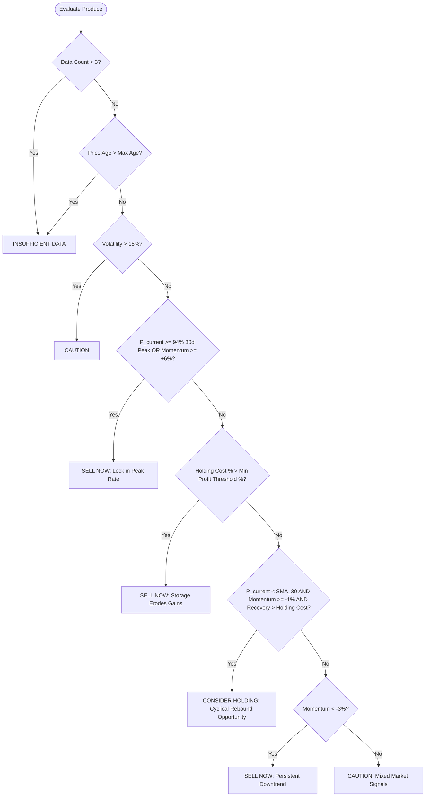

# Features & Mathematical Calculations — Mandi Mitra

This document outlines the mathematical formulas, rules, and algorithmic assumptions implemented in Mandi Mitra.

---

## 1. Mandi Profit Comparison Engine

### Objective
Rank available regional APMC mandis by the estimated **Net Revenue in Hand** rather than the gross mandi price.

### A. Geodesic Distance (Haversine Formula)
Because exact road networks vary across rural routes, distance is calculated as the approximate straight-line geodesic distance on the Earth's surface:

$$\Delta\phi = \text{radians}(\text{lat}_2 - \text{lat}_1)$$

$$\Delta\lambda = \text{radians}(\text{lon}_2 - \text{lon}_1)$$

$$a = \sin^2\left(\frac{\Delta\phi}{2}\right) + \cos(\text{lat}_1)\cos(\text{lat}_2)\sin^2\left(\frac{\Delta\lambda}{2}\right)$$

$$c = 2 \cdot \text{atan2}\left(\sqrt{a}, \sqrt{1 - a}\right)$$

$$d = R \cdot c$$

Where:
- $R = 6,371.0088\text{ km}$ (mean radius of Earth).
- Distance $d$ is labeled in the user interface as **Approximate Straight-Line Distance**. Actual road distance is typically 15–25% higher.

### B. Gross Revenue
$$\text{Gross Revenue (₹)} = \text{Quantity (quintals)} \times \text{Market Price per Quintal (₹/qtl)}$$

### C. Transportation Freight Expense
$$\text{Transport Cost (₹)} = d\text{ (km)} \times \text{Vehicle Rate per KM (₹/km)}$$

### D. Total Selling Expenses
$$\text{Total Expenses (₹)} = \text{Transport Cost} + \text{Other Expenses}$$

Where $\text{Other Expenses}$ include loading, unloading, weighing, and APMC cess charges entered by the farmer.

### E. Estimated Net Revenue & Net Rate
$$\text{Net Revenue (₹)} = \text{Gross Revenue} - \text{Total Expenses}$$

$$\text{Net Rate per Quintal (₹/qtl)} = \frac{\text{Net Revenue}}{\text{Quantity}}$$

### F. Ranking Logic
Mandis within the farmer's search radius ($25, 50, 100, 200\text{ km}$) are sorted descending by:
1. Primary: $\text{Net Revenue}$ (highest net profit first).
2. Secondary tie-breaker: Shorter distance $d$.
3. Tertiary tie-breaker: Higher gross price.
The top-ranked entry is marked with `is_recommended = True` and receives the **#1 Best Net Profit** badge.

---

## 2. Sell-or-Hold Advisory Engine

### Objective
Provide transparent, explainable rule-based decision support evaluating whether to sell immediately or hold for 1, 3, or 7 days.

### A. Moving Averages
- **7-Day Simple Moving Average ($SMA_7$)**: Mean modal price over the most recent 7 daily records.
- **30-Day Simple Moving Average ($SMA_{30}$)**: Mean modal price over the most recent 30 daily records.

### B. Price Momentum
$$\text{Momentum}_{7d}\text{ (\%)} = \left(\frac{P_{\text{current}} - SMA_7}{SMA_7}\right) \times 100$$

### C. Historical Volatility
$$\sigma = \sqrt{\frac{1}{N}\sum_{i=1}^N (P_i - SMA_{30})^2}$$

$$\text{Volatility (\%)} = \left(\frac{\sigma}{SMA_{30}}\right) \times 100$$

### D. Holding Cost Calculation
$$\text{Holding Cost per Quintal} = \text{Daily Storage Rate (₹/qtl/day)} \times \text{Holding Period (days)}$$

$$\text{Total Holding Cost (₹)} = \text{Quantity (qtl)} \times \text{Holding Cost per Quintal}$$

$$\text{Holding Cost Impact (\%)} = \left(\frac{\text{Holding Cost per Quintal}}{P_{\text{current}}}\right) \times 100$$

---

## 3. Advisory Decision Rules

---

## 4. Rule Signal Strength Formula

Rather than presenting an arbitrary confidence number, Mandi Mitra calculates a calibrated **Rule Signal Strength** percentage based on three verifiable dimensions:

1. **Freshness Score ($S_{\text{fresh}}$)**:
   $$S_{\text{fresh}} = \max\left(0, \left(1 - \frac{\text{Price Age Days}}{\text{Max Acceptable Days}}\right) \times 100\right)$$
2. **Data Depth Score ($S_{\text{depth}}$)**:
   $$S_{\text{depth}} = \min\left(100, \frac{\text{Historical Data Points}}{30} \times 100\right)$$
3. **Stability Score ($S_{\text{stab}}$)**:
   $$S_{\text{stab}} = \max\left(20, 100 - \min(80, \text{Volatility \%} \times 2.5)\right)$$

$$\mathbf{\text{Signal Strength}} = (0.40 \times S_{\text{fresh}}) + (0.35 \times S_{\text{depth}}) + (0.25 \times S_{\text{stab}})$$
