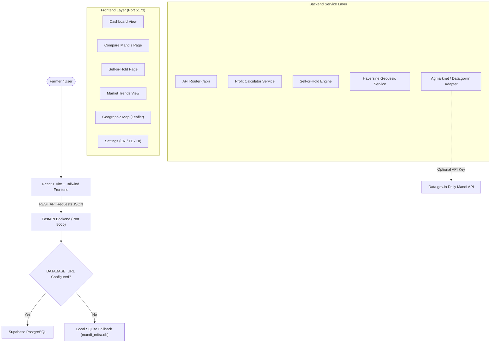

# Project Overview — Mandi Mitra

## 1. Problem Statement

Indian agriculture involves over 140 million farming households. While substantial policy focus is placed on Minimum Support Prices (MSP) and agricultural credit, small and marginal farmers encounter severe **asymmetric market information** and **logistical margin leakage** during post-harvest disposal:

1. **Gross Price Illusion**: A distant APMC market yard may announce a higher gross modal price per quintal. However, when factoring in mini-truck freight, loading, unloading, weighing charges, and market cess, the farmer often realizes a lower net return than selling at a nearer local mandi.
2. **Selling Timing Dilemma**: Farmers face acute uncertainty regarding whether to sell their harvested crop immediately at prevailing gate rates or to hold it for 3–7 days in the hope of price recovery. Without quantitative analysis of holding costs (warehouse rent, fumigation, moisture loss) versus price momentum, holding produce often amplifies financial losses.
3. **Complex Interfaces**: Many existing agricultural portals are built with dense tables that are difficult to navigate on mobile devices and lack regional language options.

---

## 2. Solution: Mandi Mitra

**Mandi Mitra** is an explainable decision-support web application that empowers farmers with transparent, mathematically verifiable market comparisons:

- **Net Revenue Optimization**: Mandis are evaluated and ranked strictly by **Net Revenue in Hand** after subtracting all vehicle freight and handling costs.
- **Rule-Based Sell-or-Hold Decision Support**: Instead of obscure black-box predictive models, Mandi Mitra uses transparent moving averages ($SMA_7, SMA_{30}$), momentum indicators, and farmer-configured storage costs to provide one of four clear outcomes:
  - `SELL NOW`
  - `CONSIDER HOLDING`
  - `CAUTION`
  - `INSUFFICIENT DATA`
- **Authentic Indian Mandi Coverage**: Pre-seeded with verified geographic coordinates and APMC markets across major agricultural states including Telangana, Andhra Pradesh, Maharashtra, Karnataka, Punjab, and Madhya Pradesh.
- **Trilingual Accessibility**: Fully operational in **English**, **తెలుగు (Telugu)**, and **हिन्दी (Hindi)**.

---

## 3. High-Level Architecture

---

## 4. System Actors & Roles

1. **Farmer / Trader (End User)**:
   - Enters crop variety, harvest quantity (quintals), location, and transport rate.
   - Evaluates ranked mandis by net revenue.
   - Reviews transparent sell-or-hold advice before committing vehicle freight.
2. **FastAPI Application Server**:
   - Validates requests via Pydantic schemas.
   - Executes Haversine geodesic distance filtering.
   - Computes gross revenues, vehicle transport costs, and net revenue rankings.
   - Evaluates time series data against rule-based advisory logic.
3. **Database Layer (Supabase PostgreSQL / SQLite)**:
   - Stores states, districts, APMC mandis, commodities, varieties, daily market prices, and user preferences.
4. **Agmarknet / Data.gov.in Adapter**:
   - Queries public government market price endpoints when an API key is supplied.
   - Normalizes raw incoming data to standard rupees per quintal.
   - Enforces offline benchmark fallback when external networks are unavailable.

---

## 5. Design Principles

- **No Artificial Live Claims**: If live government API access is unavailable, data is explicitly classified as `benchmark` or `historical`.
- **Explainability Over Black Boxes**: Every recommendation is accompanied by itemized reasons, observed price swings, and risk factors.
- **Mobile-First Responsiveness**: Designed with high-contrast buttons, readable typography, and accessible cards suitable for field conditions.
- **Zero-Friction Local Execution**: Operates out-of-the-box using the verified benchmark dataset even before external database credentials are configured.
